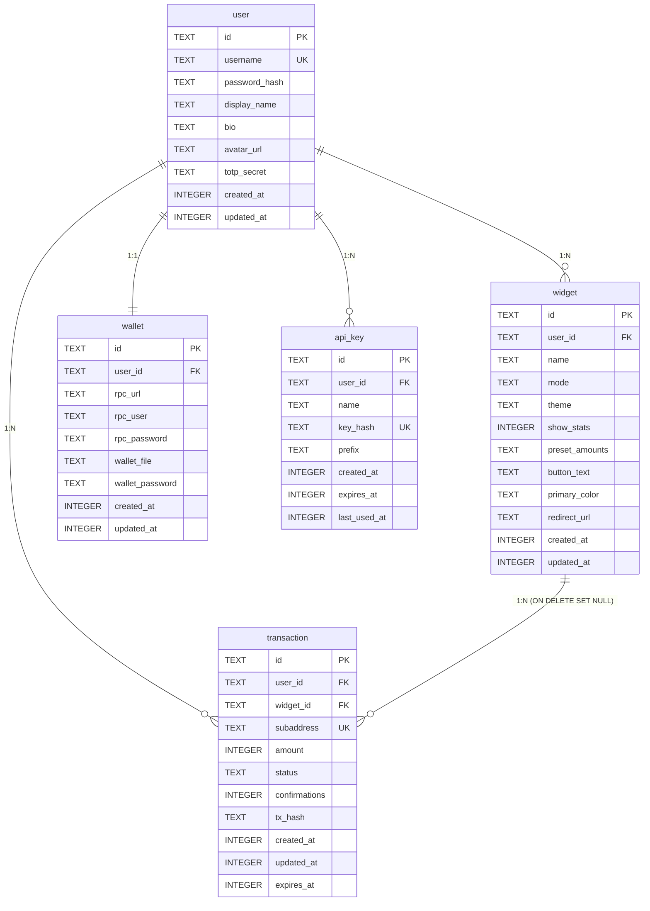

# Database Schema

Tiponero uses SQLite in WAL (Write-Ahead Logging) mode. The schema is created inline during application startup via idempotent `CREATE TABLE IF NOT EXISTS` statements. There are no migration files: the schema is defined in `internal/database/sqlite.go`.

The database file location is controlled by the `DATABASE_PATH` environment variable. If unset, an in-memory database is used (data lost on restart).

## Tables

### `user`

Stores admin user accounts. Tiponero seeds a default `admin`/`admin` user on first startup if no users exist.

```sql
CREATE TABLE IF NOT EXISTS user (
    id            TEXT PRIMARY KEY,   -- UUID v4
    username      TEXT UNIQUE NOT NULL,
    password_hash TEXT NOT NULL,       -- bcrypt hash
    display_name  TEXT,
    bio           TEXT,
    avatar_url    TEXT,
    totp_secret   TEXT,                -- empty string = 2FA disabled
    created_at    INTEGER NOT NULL,    -- Unix timestamp
    updated_at    INTEGER NOT NULL     -- Unix timestamp
);
```

### `widget`

Configures donation or payment widgets. Each widget belongs to a user and defines the UI appearance, preset amounts, and behavior.

```sql
CREATE TABLE IF NOT EXISTS widget (
    id                TEXT PRIMARY KEY,   -- UUID v4
    user_id           TEXT NOT NULL REFERENCES user(id),
    name              TEXT NOT NULL,
    mode              TEXT NOT NULL DEFAULT 'donation',   -- 'donation' | 'payment'
    theme             TEXT NOT NULL DEFAULT 'system',     -- 'system' | 'light' | 'dark'
    show_stats        INTEGER NOT NULL DEFAULT 1,
    preset_amounts    TEXT,                -- JSON array of floats (XMR)
    button_text       TEXT DEFAULT 'Donate',
    custom_message    TEXT DEFAULT 'Your support is appreciated!',
    thank_you_message TEXT DEFAULT 'Thank you for your donation!',
    primary_color     TEXT DEFAULT '#ff6600',  -- hex color
    redirect_url      TEXT,                    -- used in payment mode
    created_at        INTEGER NOT NULL,        -- Unix timestamp
    updated_at        INTEGER NOT NULL         -- Unix timestamp
);

CREATE INDEX IF NOT EXISTS idx_widget_user ON widget(user_id);
```

| Field | Type | Notes |
|---|---|---|
| `mode` | `donation` or `payment` | Donation = open amount, Payment = fixed amount with redirect |
| `theme` | `system`, `light`, or `dark` | Controls widget appearance; `system` follows visitor's OS preference |
| `preset_amounts` | JSON array | e.g. `[0.01, 0.05, 0.1]`: preset XMR amounts shown as buttons |
| `redirect_url` | string | In payment mode, the user is redirected here after confirmation |

### `transaction`

Records every payment or donation. Each transaction is linked to a unique Monero subaddress.

```sql
CREATE TABLE IF NOT EXISTS "transaction" (
    id                TEXT PRIMARY KEY,   -- UUID v4
    user_id           TEXT NOT NULL REFERENCES user(id),
    widget_id         TEXT REFERENCES widget(id) ON DELETE SET NULL,
    subaddress        TEXT NOT NULL UNIQUE,
    subaddress_index  INTEGER NOT NULL,
    amount            INTEGER,            -- piconero (1 XMR = 1,000,000,000,000)
    fiat_amount       REAL,
    fiat_currency     TEXT,
    status            TEXT NOT NULL DEFAULT 'pending',
    confirmations     INTEGER DEFAULT 0,
    is_payment        INTEGER NOT NULL DEFAULT 0,  -- 0 = donation, 1 = payment
    donor_name        TEXT,
    note              TEXT,
    tx_hash           TEXT,
    created_at        INTEGER NOT NULL,   -- Unix timestamp
    updated_at        INTEGER NOT NULL,
    confirmed_at      INTEGER,
    expires_at        INTEGER NOT NULL
);

CREATE INDEX IF NOT EXISTS idx_transaction_status     ON "transaction"(status);
CREATE INDEX IF NOT EXISTS idx_transaction_subaddress ON "transaction"(subaddress);
CREATE INDEX IF NOT EXISTS idx_transaction_user       ON "transaction"(user_id);
CREATE INDEX IF NOT EXISTS idx_transaction_widget     ON "transaction"(widget_id);
```

**Transaction statuses:**

| Status | Meaning |
|---|---|
| `pending` | Subaddress generated, waiting for payment |
| `mempool` | Transaction detected in the mempool (unconfirmed) |
| `confirming` | Transaction included in a block, accumulating confirmations |
| `confirmed` | Required number of confirmations reached |
| `expired` | No payment received before `expires_at` |

**Amount storage:** Amounts are stored in **piconero** as `INTEGER`. 1 XMR = 1,000,000,000,000 piconero. This avoids floating-point precision issues.

### `wallet`

Stores the `monero-wallet-rpc` connection configuration. One wallet per user, enforced at the application level.

```sql
CREATE TABLE IF NOT EXISTS wallet (
    id               TEXT PRIMARY KEY,   -- UUID v4
    user_id          TEXT NOT NULL REFERENCES user(id),
    rpc_url          TEXT,
    rpc_user         TEXT,
    rpc_password     TEXT,               -- AES-256-GCM encrypted, base64-encoded
    wallet_file      TEXT,
    wallet_password  TEXT,               -- AES-256-GCM encrypted, base64-encoded
    created_at       INTEGER NOT NULL,
    updated_at       INTEGER NOT NULL
);
```

:::info
The `rpc_password` and `wallet_password` fields are encrypted at rest using AES-256-GCM. The encryption key is derived via HKDF from the `ENCRYPTION_KEY` environment variable with the context string `"wallet"`. They are never returned in API responses.
:::

### `api_key`

Stores API keys for programmatic access. Keys are bcrypt-hashed. Lookup uses an 8-character prefix for efficient candidate selection before bcrypt comparison.

```sql
CREATE TABLE IF NOT EXISTS api_key (
    id           TEXT PRIMARY KEY,   -- UUID v4
    user_id      TEXT NOT NULL REFERENCES user(id),
    name         TEXT NOT NULL,
    key_hash     TEXT NOT NULL UNIQUE,   -- bcrypt hash of "tip_<32hex>"
    prefix       TEXT NOT NULL,          -- characters 4-12 of the raw key
    created_at   INTEGER NOT NULL,
    expires_at   INTEGER NOT NULL,       -- max 365 days from creation
    last_used_at INTEGER
);

CREATE INDEX IF NOT EXISTS idx_api_key_prefix ON api_key(prefix);
CREATE INDEX IF NOT EXISTS idx_api_key_user   ON api_key(user_id);
```

**Key format:** `tip_<32 hex characters>` (e.g. `tip_a1b2c3d4e5f6a1b2c3d4e5f6a1b2c3d4`). The raw key is shown exactly once at creation time and cannot be retrieved afterward.

## Entity Relationships



## Design Notes

- **No ORM:** all queries use raw `database/sql` with hand-written SQL. This keeps the dependency footprint small and query behavior explicit.
- **UUID v4 primary keys:** generated via SQLite's `randomblob()` function, formatted as standard UUID strings.
- **Unix timestamps:** all timestamps are stored as `INTEGER` (seconds since epoch). No timezone ambiguity.
- **WAL mode:** enabled at database open time. Allows concurrent readers during writes, which is important since the payment monitor writes every 30 seconds while the admin panel serves read requests.

## Full Reference

This page summarizes the tables. For each column, index, relation, and storage rule, read [Data Model](/docs/internals/data-model).
