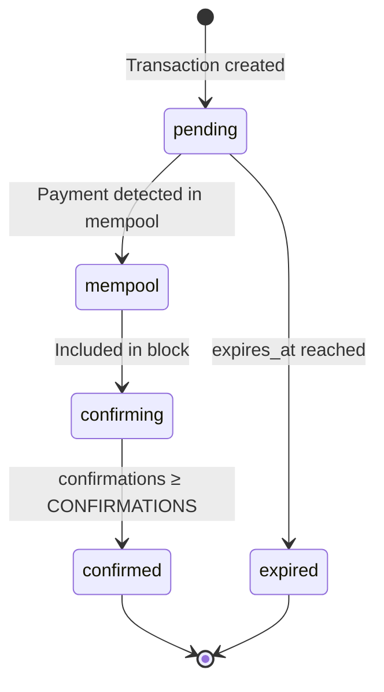

# Payment Lifecycle

Every donation or payment in Tiponero follows a deterministic state machine. Understanding this lifecycle is important for integrating with the API and debugging payment issues.

## State Machine



## States

| State | Description | Triggers |
|---|---|---|
| `pending` | Subaddress created, QR code displayed, waiting for payment | Transaction created via widget or API |
| `mempool` | Payment detected in the Monero mempool (0 confirmations) | Payment monitor detects transfer in `pool` |
| `confirming` | Transaction included in a block, accumulating confirmations | Payment monitor detects transfer in `in` with confirmations < threshold |
| `confirmed` | Required confirmations reached, payment complete | Confirmations ≥ `CONFIRMATIONS` env var value |
| `expired` | No payment received before the expiry deadline | `expires_at` timestamp passed, checked every 30 seconds |

## Detailed Flow

### 1. Transaction Creation

When a user submits a donation or payment through a widget:

1. Tiponero calls `create_address` on `monero-wallet-rpc` to generate a unique subaddress
2. A transaction record is created in the database with status `pending`
3. The `expires_at` timestamp is set to `now + TRANSACTION_EXPIRY` (default: 1 hour)
4. If `FIAT_CURRENCY` is configured, the current XMR/fiat rate is fetched from CoinGecko and stored as a snapshot
5. The widget displays a QR code with a `monero:` URI containing the subaddress and amount
6. HTMX begins polling the transaction status endpoint every 5 seconds

### 2. Payment Monitoring

The `PaymentMonitor` goroutine runs on a 30-second ticker:

1. **Expire stale transactions:** any `pending` transaction past `expires_at` is marked `expired`
2. **Poll `monero-wallet-rpc`:** calls `get_transfers` for `in`, `pending`, and `pool` transfer types
3. **Index by subaddress:** all returned transfers are indexed by their subaddress for fast lookup
4. **Match against active transactions:** for each `pending`, `mempool`, or `confirming` transaction:
   - If a matching transfer is found in the `pool`: status → `mempool`
   - If found in `in` with confirmations < threshold: status → `confirming`, update confirmation count
   - If found in `in` with confirmations ≥ threshold: status → `confirmed`, record `confirmed_at` and `tx_hash`

### 3. Real-Time Updates

While the widget is open, HTMX polls `GET /widget/{widgetID}/donation/{donationID}/status` every 5 seconds:

- Returns an HTML fragment showing the current status
- On `mempool`: displays "Payment detected, waiting for confirmations"
- On `confirming`: displays confirmation progress (e.g. "3/10 confirmations")
- On `confirmed`: sets an `HX-Redirect` header
  - **Donation mode:** redirects to the thank-you view
  - **Payment mode:** redirects to the widget's configured `redirect_url`
- On `expired`: displays an expiration message

### 4. Fiat Conversion

If `FIAT_CURRENCY` is configured (e.g. `USD`, `EUR`):

- At transaction creation, the current XMR price is fetched from CoinGecko
- The fiat equivalent is calculated and stored in `fiat_amount` + `fiat_currency`
- This is a **snapshot**: the fiat value is frozen at the time of transaction creation
- The price service caches responses for 5 minutes to avoid rate limiting

## Configuration

| Variable | Default | Effect |
|---|---|---|
| `CONFIRMATIONS` | `10` | Number of block confirmations required to mark a transaction `confirmed` |
| `TRANSACTION_EXPIRY` | `1h` | Go duration string. How long a `pending` transaction waits before expiring |

:::tip
For low-value donations, you can reduce `CONFIRMATIONS` to `1` for faster confirmation. For high-value payments, consider increasing it to `15` or `20`.
:::

## API Interaction

You can query transaction status via the REST API:

```bash
# List all transactions with status filter
curl -H "Authorization: Bearer tip_<your_api_key>" \
  "https://your-instance.example.com/api/v1/transactions?status=confirming"

# Get a specific transaction
curl -H "Authorization: Bearer tip_<your_api_key>" \
  "https://your-instance.example.com/api/v1/transactions/<transaction-id>"
```

See the [Transactions API Reference](/docs/api/transactions) for full details.
