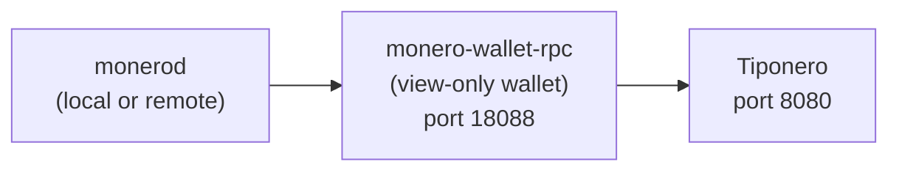

# Monero Wallet RPC Setup

Tiponero connects to `monero-wallet-rpc`, and `monero-wallet-rpc` connects to a Monero daemon (`monerod`). The daemon can be a **remote node** that you trust, or a **local node** that you run yourself.



## Install Monero CLI

Download the CLI from the [official website](https://www.getmonero.org/downloads/#cli), or install it with your package manager:

```bash
# Debian/Ubuntu
sudo apt install monero

# Arch Linux
sudo pacman -S monero

# Nix
nix-shell -p monero-cli

# macOS (Homebrew)
brew install monero
```

The package supplies both `monerod` and `monero-wallet-rpc`.

## Create a View-Only Wallet

If you already have a Monero wallet, create a view-only copy of it:

```bash
monero-wallet-cli --generate-from-keys wallet_view_only \
  --address YOUR_PRIMARY_ADDRESS \
  --viewkey YOUR_SECRET_VIEW_KEY \
  --spendkey 0000000000000000000000000000000000000000000000000000000000000000
```

If you start with a new wallet:

```bash
# Create a new wallet (save the seed phrase securely!)
monero-wallet-cli --generate-new-wallet wallet

# After setup, export the view-only wallet
monero-wallet-cli --wallet-file wallet
# Inside the wallet CLI:
# > address
# > viewkey
# Use these to create the view-only version above
```

:::warning
Never use a full wallet (with spend key) on the Tiponero server. Always use a view-only wallet. The server can monitor incoming payments, but it cannot spend your funds.
:::

## Connect to a Monero Daemon

### Option A: Remote Node (Recommended)

With a remote node, you do not run `monerod`. You skip the multi-day blockchain sync and the disk space requirements.

**Trade-offs:** the operator of the remote node can see that *someone* queries certain block heights. The Monero protocol still protects the sender, the receiver, and the amount with cryptography. A malicious remote node can withhold blocks and delay payment detection, but it cannot steal funds from a view-only wallet. For donation use cases, this risk is usually acceptable.

Some public remote nodes:

| Node | Address |
|---|---|
| MoneroWorld | `node.moneroworld.com:18089` |
| Cake Wallet | `xmr-node.cakewallet.com:18081` |
| Seth for Privacy | `node.sethforprivacy.com:18089` |

:::tip
Port `18089` indicates a restricted RPC endpoint (no admin commands). Use this port when you connect to a third-party node.
:::

Start `monero-wallet-rpc` with a remote daemon:

```bash
monero-wallet-rpc \
  --rpc-bind-ip=127.0.0.1 \
  --rpc-bind-port=18088 \
  --rpc-login=rpc_user:rpc_password \
  --daemon-address=node.moneroworld.com:18089 \
  --wallet-file=/path/to/wallet_view_only \
  --password-file=/path/to/wallet.passwd \
  --non-interactive
```

Public remote nodes do not need `--daemon-login`.

### Option B: Local Node

Your own `monerod` gives you full control. You trust no third party, and no metadata leaves your server. You do not depend on the uptime of another operator.

Start a pruned node. A pruned node decreases the disk use from ~200GB to ~50GB:

```bash
monerod \
  --prune-blockchain \
  --db-sync-mode=safe \
  --rpc-bind-ip=127.0.0.1 \
  --rpc-bind-port=18081 \
  --rpc-login=rpc_user:rpc_password \
  --detach
```

:::info
The initial sync takes from several hours to days, and it depends on the hardware and the network. Show the progress with `monerod status`.
:::

Then start `monero-wallet-rpc` and point it at your local daemon:

```bash
monero-wallet-rpc \
  --rpc-bind-ip=127.0.0.1 \
  --rpc-bind-port=18088 \
  --rpc-login=rpc_user:rpc_password \
  --daemon-address=127.0.0.1:18081 \
  --daemon-login=rpc_user:rpc_password \
  --wallet-file=/path/to/wallet_view_only \
  --password-file=/path/to/wallet.passwd \
  --non-interactive
```

## Verify the Connection

Make sure that `monero-wallet-rpc` answers:

```bash
curl -s -X POST http://127.0.0.1:18088/json_rpc \
  --digest -u rpc_user:rpc_password \
  -H "Content-Type: application/json" \
  -d '{"jsonrpc":"2.0","id":"0","method":"get_height"}' | python3 -m json.tool
```

Expected response:

```json
{
    "id": "0",
    "jsonrpc": "2.0",
    "result": {
        "height": 3150000
    }
}
```

## Troubleshooting

### The Monero GUI is running, but nothing listens on the RPC port

The GUI starts `monerod`, not `monero-wallet-rpc`. The GUI application links the wallet code directly and never opens a JSON-RPC server. The full GUI manual has no RPC section at all.

**Merchant mode is not an RPC server.** The GUI has a Merchant tab that creates payment requests and watches incoming transfers. It runs inside the GUI window. It does not listen on a port, and no other program can call it.

The GUI release does ship the binary, which is why people remember starting it "from the GUI". Look next to the GUI executable:

```text
monero-gui-v0.18.x/
├── monerod
├── monero-wallet-gui
└── extras/
    ├── monero-wallet-cli
    └── monero-wallet-rpc
```

On Windows the default install folder is `C:\Program Files\Monero GUI Wallet\`, and `monero-wallet-rpc.exe` is in it.

Start it yourself:

```bash
./extras/monero-wallet-rpc \
  --wallet-dir=/path/to/wallets \
  --rpc-bind-port=18088 \
  --rpc-login=rpc_user:rpc_password \
  --daemon-address=127.0.0.1:18081
```

If the GUI uses a remote node, pass that node's address instead, usually on port `18089` (restricted RPC).

:::warning
Do not point `monero-wallet-rpc` at the same wallet file that the GUI has open. Two processes writing one wallet file cause lock and sync problems. The Monero documentation recommends two wallet files for the same keys: one for the GUI, one for the RPC.

For Tiponero the better option is a view-only wallet. Export the address and private view key from the GUI under **Settings > Seeds & Keys**, then let Tiponero create a separate view-only wallet file with **Settings > Create a View-Only Wallet**. The GUI keeps the only copy of the spend key.
:::

### Which port should I use?

`monero-wallet-rpc` has no default port. You choose one with `--rpc-bind-port`. Monero reserves these ports on mainnet:

| Port | Service |
|---|---|
| 18081 | `monerod` unrestricted JSON-RPC |
| 18082 | `monerod` ZMQ RPC |
| 18083 | `monerod` ZMQ Pub |
| 18088 | Wallet RPC (reserved for this use) |
| 18089 | `monerod` restricted JSON-RPC |

Port `18083` is the ZMQ publisher. It is not the wallet RPC and it does not answer JSON-RPC requests. Use `18088` unless you already run something there.

On stagenet, the same ports shift by 20000: wallet RPC is `38088`.

### Connection errors

| Error | Cause |
|---|---|
| `connection refused` | `monero-wallet-rpc` is not running, or it listens on a different port |
| `401 Unauthorized` | The user name or password does not match `--rpc-login` |
| `404 Not Found` | The URL already ends in `/json_rpc` and the client adds it again |
| `Method not found` | The URL points at `monerod` instead of `monero-wallet-rpc` |

In the admin panel, enter the base address only: `http://127.0.0.1:18088`. Tiponero appends `/json_rpc` itself. A pasted `http://127.0.0.1:18088/json_rpc` also works now, because the client removes the suffix.

## Next Steps

- [Running as systemd Services](/docs/deployment/systemd-services): production service files and network requirements
- [Testing on Stagenet](/docs/deployment/stagenet-testing): test the full payment lifecycle with free XMR
- [Build from Source (Makefile)](/docs/deployment/makefile)
- [Docker](/docs/deployment/docker)
- [NixOS](/docs/deployment/nixos)
