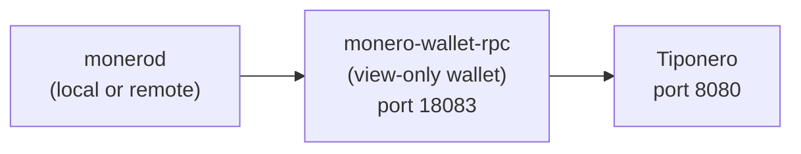

# Monero Wallet RPC Setup

Tiponero connects to `monero-wallet-rpc`, which in turn connects to a Monero daemon (`monerod`). The daemon can be either a **remote node** you trust or a **local node** you run yourself.



## Install Monero CLI

Download from the [official website](https://www.getmonero.org/downloads/#cli) or install via your package manager:

```bash
# Debian/Ubuntu
sudo apt install monero

# Arch Linux
sudo pacman -S monero

# Nix
nix-shell -p monero-cli

# macOS (Homebrew)
brew install monero
```

This provides both `monerod` and `monero-wallet-rpc`.

## Create a View-Only Wallet

If you already have a Monero wallet, create a view-only version:

```bash
monero-wallet-cli --generate-from-keys wallet_view_only \
  --address YOUR_PRIMARY_ADDRESS \
  --viewkey YOUR_SECRET_VIEW_KEY \
  --spendkey 0000000000000000000000000000000000000000000000000000000000000000
```

If you're starting from scratch:

```bash
# Create a new wallet (save the seed phrase securely!)
monero-wallet-cli --generate-new-wallet wallet

# After setup, export the view-only wallet
monero-wallet-cli --wallet-file wallet
# Inside the wallet CLI:
# > address
# > viewkey
# Use these to create the view-only version above
```

:::warning
Never use a full wallet (with spend key) on the Tiponero server. Always use a view-only wallet. The server can monitor incoming payments but cannot spend your funds.
:::

## Connect to a Monero Daemon

### Option A: Remote Node (Recommended)

A remote node lets you skip running `monerod` entirely. No multi-day blockchain sync, no disk space requirements.

**Trade-offs:** the remote node operator can see that *someone* is querying certain block heights, but Monero's protocol still protects sender, receiver, and amount cryptographically. A malicious remote node could withhold blocks, delaying payment detection, but cannot steal funds from a view-only wallet. For donation use cases this is usually acceptable.

Some public remote nodes:

| Node | Address |
|---|---|
| MoneroWorld | `node.moneroworld.com:18089` |
| Cake Wallet | `xmr-node.cakewallet.com:18081` |
| Seth for Privacy | `node.sethforprivacy.com:18089` |

:::tip
Port `18089` indicates a restricted RPC endpoint (no admin commands), which is what you want when connecting to a third-party node.
:::

Start `monero-wallet-rpc` with a remote daemon:

```bash
monero-wallet-rpc \
  --rpc-bind-ip=127.0.0.1 \
  --rpc-bind-port=18083 \
  --rpc-login=rpc_user:rpc_password \
  --daemon-address=node.moneroworld.com:18089 \
  --wallet-file=/path/to/wallet_view_only \
  --password-file=/path/to/wallet.passwd \
  --non-interactive
```

No `--daemon-login` is needed for public remote nodes.

### Option B: Local Node

Running your own `monerod` gives you full sovereignty: no trust in third parties, no metadata leakage, no dependency on someone else's uptime.

Start a pruned node (reduces disk usage from ~200GB to ~50GB):

```bash
monerod \
  --prune-blockchain \
  --db-sync-mode=safe \
  --rpc-bind-ip=127.0.0.1 \
  --rpc-bind-port=18081 \
  --rpc-login=rpc_user:rpc_password \
  --detach
```

:::info
Initial sync takes several hours to days depending on hardware and network. Check progress with `monerod status`.
:::

Then start `monero-wallet-rpc` pointing at your local daemon:

```bash
monero-wallet-rpc \
  --rpc-bind-ip=127.0.0.1 \
  --rpc-bind-port=18083 \
  --rpc-login=rpc_user:rpc_password \
  --daemon-address=127.0.0.1:18081 \
  --daemon-login=rpc_user:rpc_password \
  --wallet-file=/path/to/wallet_view_only \
  --password-file=/path/to/wallet.passwd \
  --non-interactive
```

## Verify the Connection

Test that `monero-wallet-rpc` is responding:

```bash
curl -s -X POST http://127.0.0.1:18083/json_rpc \
  --digest -u rpc_user:rpc_password \
  -H "Content-Type: application/json" \
  -d '{"jsonrpc":"2.0","id":"0","method":"get_height"}' | python3 -m json.tool
```

Expected response:

```json
{
    "id": "0",
    "jsonrpc": "2.0",
    "result": {
        "height": 3150000
    }
}
```

## Next Steps

- [Running as systemd Services](/docs/deployment/systemd-services): production service files and network requirements
- [Testing on Stagenet](/docs/deployment/stagenet-testing): test the full payment lifecycle with free XMR
- [Build from Source (Makefile)](/docs/deployment/makefile)
- [Docker](/docs/deployment/docker)
- [NixOS](/docs/deployment/nixos)
