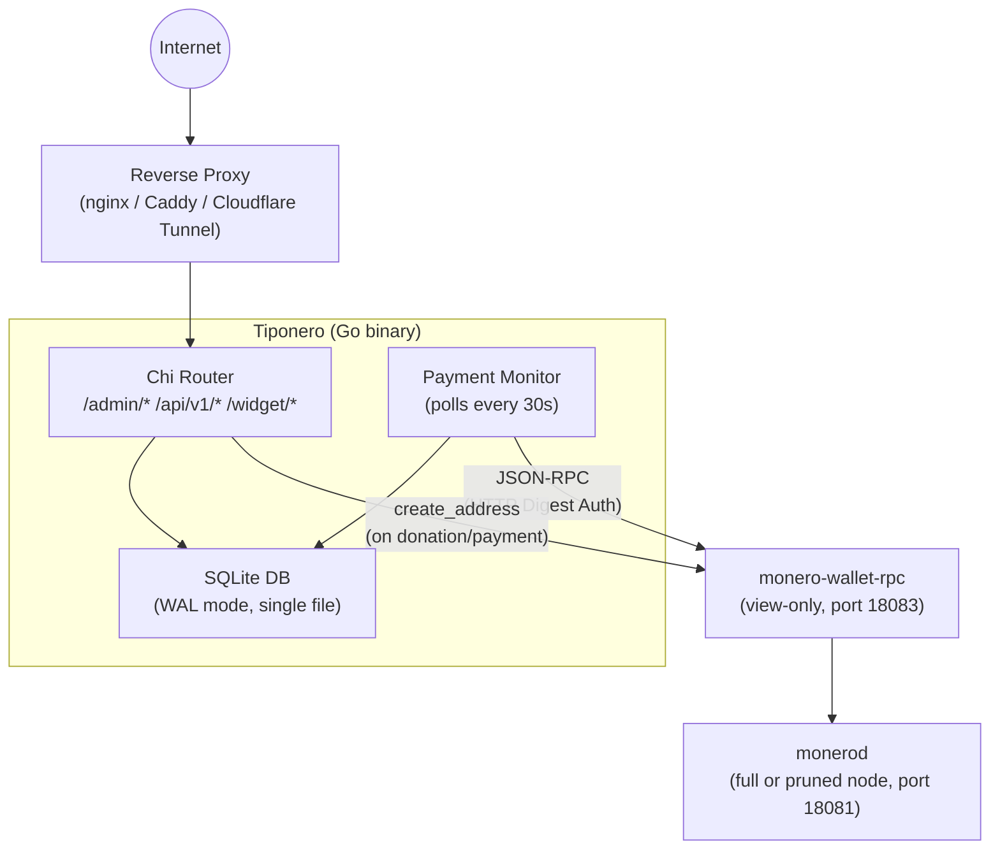
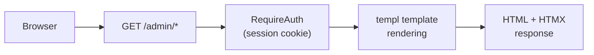
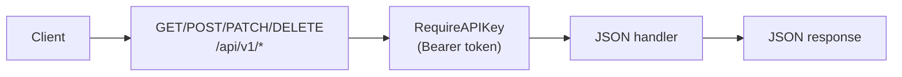
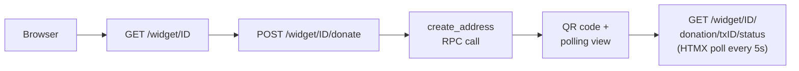

# Architecture Overview

Tiponero is a single Go binary that bundles an HTTP server, an embedded SQLite database, an HTMX-based admin panel, and a background payment monitor. It connects to your `monero-wallet-rpc` instance over JSON-RPC to generate subaddresses and track incoming transfers.

## System Architecture

## Component Responsibilities

| Component | Role |
|---|---|
| **Chi Router** | HTTP routing, middleware (session auth, API key auth), static file serving |
| **Admin Handlers** | Server-rendered HTML via `templ` templates, HTMX-powered interactions |
| **API Handlers** | JSON REST API with Bearer token authentication |
| **Widget Handlers** | Public-facing payment/donation widgets, QR code generation, real-time status polling |
| **Payment Monitor** | Background goroutine that polls `monero-wallet-rpc` every 30 seconds for incoming transfers |
| **Price Service** | Fetches XMR/fiat rates from CoinGecko, cached for 5 minutes |
| **SQLite Database** | Single-file database in WAL mode: users, widgets, transactions, wallet config, API keys |
| **Crypto Module** | AES-256-GCM encryption for wallet passwords, HKDF key derivation from master `ENCRYPTION_KEY` |
| **Monero RPC Client** | JSON-RPC 2.0 client with HTTP Digest Auth, thread-safe hot-swappable client holder |

## Request Flow

### Admin UI

### REST API

### Widget (Public)

## Key Design Decisions

- **Single binary:** all static assets (CSS, JS, images) are embedded at compile time via `go:embed`. No external file dependencies at runtime.
- **SQLite with WAL:** no separate database server needed. WAL mode provides concurrent read access during writes.
- **View-only wallet:** the `monero-wallet-rpc` instance runs with a view-only wallet. Tiponero can see incoming payments but cannot spend funds.
- **Per-transaction subaddresses:** each payment/donation gets a unique Monero subaddress via `create_address` RPC. Addresses are never reused.
- **Hot-swappable RPC client:** changing wallet configuration in the admin panel immediately updates the live RPC connection without restarting the server.
- **AES-256-GCM at rest:** wallet RPC passwords are encrypted before storage. Keys are derived via HKDF from the `ENCRYPTION_KEY` environment variable with separate derivation contexts for sessions and wallet data.
